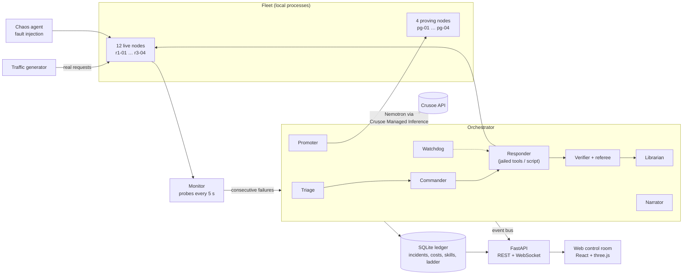

# Understudy

**An autonomous on-call team of AI agents that keeps an inference fleet healthy, and gets cheaper at it every time it learns a fix.**

Built on NVIDIA Nemotron models served by Crusoe Managed Inference.

**Live demo: https://understudy-pi-two.vercel.app/**

---

## The problem

On-call for an inference fleet is expensive and repetitive. The same handful of failures (a mistyped model ID, a stale endpoint, a full disk, a crashed worker, a port squatter) recur across nodes, and each one pages a person who rediscovers the same fix. Pointing a frontier model at every incident is no better: it is slow, it costs the same on the hundredth occurrence as on the first, and it will happily claim a fix that did not happen.

## What Understudy does

Understudy runs a 16-node fleet (12 live racks in 3 rows of 4, plus 4 held-out proving-ground nodes) under real traffic, injects realistic faults, and lets a team of agents detect, triage, fix and verify each incident with no human in the loop. Every fix is checked by a deterministic referee before it counts, and every dollar spent is recorded in a SQLite ledger.

| Agent | Model | What it does |
|---|---|---|
| **Triage** | NANO, escalating to SUPER | Classifies an incident's symptom into one of the known fault classes. |
| **Commander** | SUPER | Routes each incident to a responder at the class's current ladder rung, and escalates a rung when one gets stuck. |
| **Responder** | by rung | Step-limited agent loop that works one incident through a jailed, node-confined tool layer. |
| **Verifier / referee** | ULTRA (falls back to SUPER) + deterministic checks | The referee runs a deterministic health check that decides whether the incident is really fixed; the verifier grades verified trajectories. |
| **Librarian** | SUPER | Maintains versioned skill cards per fault class and compiles proven classes into fix scripts. |
| **Promoter** | code + held-out trials | Tests cheaper rungs on held-out proving-ground instances and moves the ladder up or down. |
| **Chaos** | NANO | Turns natural-language commands ("storm row 2") into fault injections and drives the autopilot fault schedule. |
| **Watchdog** | code only | Trips a responder that repeats the same action 3 times in 6 calls, exhausts its 14-step budget, or stalls for 90 s. |
| **Narrator** | NANO | Short narration lines for the control room and the "I'm back" operator briefing. |

The web app is a 3D **control room**: the data hall with each node as a rack, the agents as visible actors walking to the incidents they are working, and overlays for the ledger, the promotion ladder, captions and controls.

## The skill ladder

Each fault class sits on a rung of a three-step ladder. A promotion moves one step to the cheaper side:

```
SUPER (Nemotron-3 Super 120B)  ->  LIGHTNING (Nemotron-3.5 Lightning 30B)  ->  SCRIPT (compiled, no model call)
```

- **Learn.** After a verified fix graded 4 or higher, the librarian rewrites that class's skill card from the last three verified trajectories.
- **Promote.** The promoter tries the next cheaper rung on **5 held-out instances** (seeds from 100000, on the proving nodes pg-01 to pg-04) and promotes at **4 of 5 passes**, and only when the mean cost is below the live mean at the current rung.
- **Compile.** A class at the lightning rung with five verified lightning fixes gets a compiled fix script, statically checked and run in a sandbox. The script rung is reachable only through promotion.
- **Demote.** A class is demoted when fewer than 3 of its last 5 live incidents at its rung were fixed without escalation.
- **Generalise.** Two fault classes (`log_permission`, `upstream_storm`) are never trained on; they are run at the lightning rung every 20 minutes and their results, failures included, are stored.

The result: cost per incident is designed to fall as classes climb the ladder, and the ledger shows whether it actually did.

## Architecture



## Why it's trustworthy

- **A referee, not self-report.** An agent's "fixed it" is only a claim. A deterministic referee probes the node; claims that fail are recorded as rejected and shown on the ledger.
- **Jailed tool layer.** Responder tools resolve every path against the node's own directory and refuse anything outside it; process tools only touch that node. Nothing a responder can call reaches the referee or the ground-truth table.
- **Sandboxed scripts.** Compiled fix scripts are checked statically (only `re`, `json` and `yaml` imports, no dynamic code), then run in a separate `python -I` process with an empty environment, a 30 s limit and at most 40 tool calls, through the same jailed tool layer.
- **Held-out evaluation.** Promotions are decided on held-out seeds on separate proving nodes, and proving incidents are excluded from the ledger, the history and the report.
- **Hard budget cap.** Every model call checks `BUDGET_USD` first and stops when the recorded spend reaches it. Model calls have a 120 s timeout (10 s to connect) and bounded retries.
- **No fabricated numbers.** Every number in the live UI is computed from the ledger. Demo mode on the hosted page is clearly synthetic.

## Run it locally

Requirements: Python 3.11, Node 20+, a Crusoe Managed Inference API key.

```bash
make install                 # venv + Python deps
cp .env.example .env         # then set CRUSOE_API_KEY (single-quoted)
make check-models            # confirm the Nemotron model IDs your project can use
make autopilot               # fleet + agents + API on :8000, random faults every 20-40 s, storms ~every 5 min
make web                     # control room on http://localhost:5173
```

Working on the UI without the fleet or an API key:

```bash
make mock-events             # synthetic event stream on :8765
cd web && VITE_API_BASE=http://localhost:8765 npm run dev
```

`make stop` stops everything; `make report` prints a markdown report from the ledger.

### Environment variables

| Variable | Default | Purpose |
|---|---|---|
| `CRUSOE_API_KEY` | (required for live runs) | Crusoe Managed Inference key. Never logged; scrubbed from recorded errors. |
| `BUDGET_USD` | `20` | Hard cap on model spend; calls stop once it is reached. |
| `DEMO_MODE` | `0` | `1` enables `POST /api/demo/reset`. |
| `UNDERSTUDY_CORS_ORIGINS` | (empty) | Extra comma-separated origins allowed by CORS, on top of `localhost:5173`. `*` is ignored. |
| `UNDERSTUDY_DB` | `data/understudy.db` | SQLite file the read-only Vercel API serves. |
| `VITE_API_BASE`, `VITE_WS_URL`, `VITE_BACKEND_URL` | see `web/README.md` | Where the web app finds the backend. |

## Controls

| Key | Action |
|---|---|
| S | Send a storm (2 random rows) |
| B | "I'm back" briefing |
| R | Replay the whole run as a 20 second time-lapse |
| F | Fullscreen |
| M | Mute |
| hold Space | Push to talk (when `window.understudyVoice` is defined) |

## Tests

```bash
make test-fast    # everything except tests that call the real Crusoe API
make test         # including live tests (needs CRUSOE_API_KEY)
cd web && npm run build   # type-check and build the web app
```

The Python suite covers the fault injectors, the referee, the agent protocol and loop, the ledger and learning maths, the scripts sandbox, the API (including input validation and CORS) and the read-only Vercel API's behaviour on a missing or corrupt snapshot.

## Security

- The Crusoe key is read from the environment only, never sent to the browser, and replaced with `***` in any recorded error.
- API inputs are validated: node IDs must match `^[a-z0-9-]+$`, fault classes must be known classes, storm rows must be inside the hall, chaos commands are capped at 500 characters, history cursors are clamped.
- CORS is closed by default (local dev origins only); add deployed origins explicitly with `UNDERSTUDY_CORS_ORIGINS`.
- The Vercel API is read-only (GET only) and opens its SQLite snapshot with `immutable=1`; a missing, corrupt or locked file returns empty payloads, never a 500.
- The mutating endpoints (`/api/chaos`, `/api/inject`, `/api/storm`, `/api/demo/reset`, …) have no authentication: run the orchestrator on a host you control, not on the open internet.

## Repo layout

```
understudy/            orchestrator, server (FastAPI + WebSocket), ledger, db, LLM client
understudy/agents/     triage, commander, responder, verifier, librarian, promoter, chaos, watchdog, narrator, tools
understudy/fleet/      node app, supervisor, faults, monitor, traffic, referee, runner
understudy/vercel_app.py   read-only API for serverless hosting
config/settings.py     model registry, prices, node layout, fault classes
scripts/               check_models, mock_events, report
web/                   the 3D control room (Vite + React + three.js)
tests/                 pytest suite
```

## Tech stack

- **Models:** NVIDIA Nemotron 3 Super 120B, Nemotron 3.5 Lightning 30B, Nemotron 3 Nano 30B, Nemotron 3 Ultra 550B (when enabled), on Crusoe Managed Inference (OpenAI-compatible API).
- **Backend:** Python 3.11, FastAPI, anyio, aiosqlite (SQLite), httpx.
- **Frontend:** Vite, React 19, TypeScript, three.js, @react-three/fiber, drei, postprocessing, zustand.
- **Hosting:** Vercel (web + read-only API); the fleet and orchestrator run on a host you control.

## Technical details

### Learning and promotion

- After a verified fix graded 4 or higher, the librarian (SUPER) rewrites that class's skill card from the last three verified trajectories and the held-out results. Cards are capped at 900 characters, versioned in the `skills` table, and rendered without version numbers so an update that changes nothing leaves the cached prompt prefix untouched. The evidence line on each card is computed from the database.
- A class sitting at the lightning rung with five verified lightning fixes gets a compiled fix script (`data/scripts/<class>.py`). The script is checked statically (only `re`, `json` and `yaml` imports, no dynamic code), then runs in a separate `python -I` process with an empty environment, a 30 s limit and at most 40 tool calls, all through the same jailed tool layer as a model responder. The script rung is reachable only through promotion.
- The promoter runs every 6 minutes and on `POST /api/promote/run` (optionally `?fault_class=...`). It tries the next cheaper rung on 5 held-out instances (seeds from 100000) on the proving nodes pg-01 to pg-04, and promotes at 4 of 5 passes when the mean cost is below the live mean at the current rung. It demotes a class when fewer than 3 of its last 5 live incidents at the rung were fixed without escalation. A trial that fails because the model API failed or stalled is run again and not counted.
- Every 20 minutes it also runs 3 instances each of the held-out classes (`log_permission`, `upstream_storm`) at the lightning rung and stores the results, failures included.
- Proving incidents are stored with `zone = 'proving'` and are excluded from the ledger, the history and the report.
- `make report` writes a markdown report to stdout and `data/report.json`; `GET /api/history` returns the same time series.

### Deploying on Vercel

`vercel.json` defines one project with two services:

- `web`: the Vite app in `web/`, served at `/`.
- `api`: a read-only FastAPI app (`understudy/vercel_app.py`), served at `/api/*`, `/healthz` and `/ws`.

The API service serves `/api/ledger`, `/api/ladder`, `/api/skills` and `/api/history` from a SQLite file. It opens the file read-only, so it needs a snapshot of `data/understudy.db` bundled with the deploy or a path in `UNDERSTUDY_DB`. `data/` is listed in `.vercelignore`, so by default no snapshot is included and the endpoints return empty payloads. The POST endpoints (`/api/chaos`, `/api/inject`, `/api/storm`, `/api/away`, `/api/back`, `/api/promote/run`, `/api/demo/reset`) are not implemented there.

Not deployed: the orchestrator, the fleet nodes, the traffic generator and the agents. They need long-lived processes, subprocesses and a writable database, so they run as a separate process (`make autopilot`) on a host you control. Vercel functions do not support WebSockets, so `/ws` returns 501 there. For the live stream, build the web app with `VITE_WS_URL=wss://<backend-host>/ws` pointing at that host; the backend allows the local dev origins for CORS, plus any listed in `UNDERSTUDY_CORS_ORIGINS`.

Environment variables:

- `UNDERSTUDY_DB`: path to the SQLite file the `api` service reads (default `data/understudy.db`).
- `VITE_WS_URL`: WebSocket URL baked into the web build (default: same origin, `ws:` or `wss:` chosen from the page protocol).
- `VITE_BACKEND_URL`: backend the Vite dev server proxies `/api`, `/healthz` and `/ws` to (default `http://127.0.0.1:8000`).

Neither service calls the other from server-side code, so no service bindings are configured. `requirements-dev.txt` holds pytest and playwright, which the function build does not need.

Locally, `make web` runs the dev server on :5173 and proxies to the backend on :8000.

## License

MIT. See [LICENSE](LICENSE).
